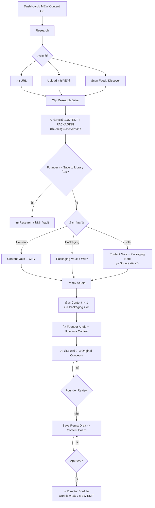

# MEW CONTENT OS — FOUNDER-LOCKED RESEARCH → SAVE → REMIX UX SPEC

**เวอร์ชัน:** 31 ตุลาคม 2026 | **ผู้รับ:** UX/UI Intern, Product Designer, PM, AI/Frontend Engineer  
**สถานะ:** Founder intent / สเปกออกแบบ ไม่ใช่หลักฐานว่า Production ทำงานแล้ว  
**โจทย์:** อธิบายผลิตภัณฑ์ตามความคิดและภาพร่างของ Founder ให้ตรงกันก่อนทำ Figma หรือเขียนโค้ด

> **กฎ 4 ประโยคที่ต้องเข้าใจตรงกัน**  
> **RESEARCH = ศึกษาว่าคลิปคนอื่นดีตรงไหน ไม่ใช่ทำคลิปใหม่**  
> **SAVE = Founder เลือกว่าอยากเก็บสิ่งใดเข้าคลัง และเพราะอะไร ไม่ใช่ AI เซฟเอง**  
> **REMIX = หยิบ Content และ Packaging จากหลาย Reference มารวมเป็น “แนวคิดต้นฉบับ” ใหม่ ไม่ใช่เอาวิดีโอมาแปะต่อกัน**  
> **CREATE = นำแนวคิดที่ผ่านการเลือกไปทำสคริปต์/ถ่าย/ตัดต่อในระบบสร้างงานเดิม**

## 0. ข้อกำหนดที่ห้ามตีความใหม่ (Non-negotiable)

1. **Research และ Remix เป็นคนละหน้าที่** และมีจุดแบ่งชัดเจนคือการตัดสินใจ **Save to Library** ของมนุษย์
2. **มีสองคลังที่แยกวิธีใช้:** `Content Vault` = เราอยากนำ **สิ่งที่พูด / แนวคิด / ประเด็น** ไปพัฒนา; `Packaging Vault` = เราอยากนำ **วิธีพูด / โครงสร้าง / Hook / Timing / Editing / SFX** ไปประยุกต์
3. คลิปเดียว **Save เข้า Content, Packaging หรือ Both** ได้ ผู้ใช้ต้องเขียนเหตุผลแยกตามคลังที่เลือก
4. **Analyze ไม่เท่ากับ Save** AI วิเคราะห์จบได้เลยโดยคลิปไม่เข้าคลัง ไม่อนุมัติให้ AI เลือกของเข้าคลังโดยอัตโนมัติ
5. **Remix หยิบได้หลายชิ้น ไม่จำกัด 1+1:** C1+P1, C1+C2+P1, C1+C2+C3+P1+P2, หรือ Content-only ก็ได้ (อย่างน้อย 1 Content)
6. **Founder คุมการเลือกวัตถุดิบและทิศทาง** AI ช่วยสังเคราะห์ เสนอ 2–3 original concepts แต่ไม่ตัดสินใจแทนว่าอันไหนอนุมัติ
7. เมื่อ Remix แล้วต้องได้ **Original Idea / Angle / Script Brief / Director Brief** ไม่ใช่แค่ข้อความสรุป Reference หรือการสลับหน้าคลิปเดิม
8. **Source ของคลิปเดียวเก็บเป็นรายการหลักเดียว** แต่มี Save Note คนละมุม; แยกประสบการณ์ผู้ใช้เป็นสองคลัง โดยไม่เก็บไฟล์ซ้ำ
9. ใช้ Content OS เดิม, Scan Feed/RADAR, Reference Vault, Business/Brand Brain, Content Board และ MEW EDIT ตามงานของแต่ละส่วน **อย่าสร้าง Editor หรือ Worker คู่ขนาน**
10. อย่าใช้ฟุตเทจ เสียง เพลง คำพูด หรือตัวเลขของคนอื่นโดยไม่มีสิทธิ์/แหล่งอ้างอิง; **ยืมหลักการได้ ไม่ได้แปลว่า copy assets ได้**

## 1. Mental Model: ทำไม Founder ถึง Research

ผู้ใช้ Research เพราะต้องการสะสม **วัตถุดิบที่ชอบ** เพื่อนำกลับมา Remix ในอนาคต ไม่ใช่เพียงรับรายงาน AI แล้วเลื่อนผ่าน คลิปที่เพิ่ง Research อาจจบโดยไม่ Save ก็ถูกต้อง หากผู้ใช้ไม่อยากนำไปใช้ต่อ ส่วนคลิปที่ควรเก็บต้องมีเหตุผลของมนุษย์ว่าอยากใช้ **WHAT** หรือ **HOW** อย่างไร

- **Content example:** “เขาบอกว่าโพสต์แล้วอย่าเฝ้ายอด ให้ไปทำคลิปต่อ ผมอยากหยิบความคิดนี้ไปเชื่อมกับ Automation ที่ช่วยตอบลูกค้าให้คนทำคอนเทนต์มีเวลาเพิ่มขึ้น”
- **Packaging example:** “เนื้อหาไม่เกี่ยวกับธุรกิจเราเลย แต่ Hook เริ่มด้วยความขัดแย้ง ตัดภาพถี่ขึ้นทีละช่วง มีเสียงนาฬิกาและเปิดเผยข้อเท็จจริงเป็นลำดับ ทำให้ดูจนจบ ผมอยากเอาวิธีเล่าไปใช้กับเรื่องอื่น”
- **Both example:** “ทั้งข้อคิดและโครงสร้างการเล่าเรื่องดี อยากเก็บประเด็นไว้ใน Content และจังหวะคลิปไว้ใน Packaging โดยใส่เหตุผลแยกกัน”

## 2. Master Workflow — อ่านตามลำดับนี้



**สำคัญ:** การออกจากหน้าวิเคราะห์โดยไม่ได้ Save ต้องไม่ทำให้คลิปกลายเป็นรายการใน Library โดยพลการ ส่วน Research Inbox จะมีประวัติการเปิด/ประวัติการนำเข้าได้ หากออกแบบไว้ แต่ **Research Inbox ไม่ใช่ Vault**

## 3. App Navigation Tree — ไม่ใช่ 5 หน้ากระจายไม่เชื่อมกัน

```text
MEW Content OS
├── 00 Overview / Dashboard
│   ├── Recent Research
│   ├── Vault Summary
│   ├── Remix Drafts
│   └── Continue work
├── 01 Research
│   ├── Paste URL / Upload / Scan Feed
│   ├── Research Inbox / Results
│   └── Clip Detail
│       ├── Video + Source Metadata
│       ├── AI Content Analysis [WHAT]
│       ├── AI Packaging Analysis [HOW]
│       └── Save to Library [opens Save Modal]
│           ├── Content + WHY
│           ├── Packaging + WHY
│           └── Both + WHY each
├── 02 My Library / Reference Vault
│   ├── Content Vault -> Saved Card -> Reference Detail
│   └── Packaging Vault -> Saved Card -> Reference Detail
│       └── Use in Remix / Add to Selection
├── 03 Remix Studio
│   ├── Reference Picker (multi-select)
│   ├── Ingredient Basket (Content N / Packaging N)
│   ├── Founder Direction / Brand Context
│   ├── Generate Original Concepts
│   └── Compare / Refine / Save Draft
└── 04 Content Board
    ├── Draft / Needs Review
    ├── Approved Recipe + Script / Director Brief
    └── Send to Existing MEW EDIT / production (เมื่อ integration พร้อมจริง)
```

## 4. Screen-by-Screen UX Contract (นักออกแบบต้องทำทุก state)

### S00 — Overview (Dashboard)

**Job:** รู้ว่ามีงานอะไร และเข้า workflow ต่อได้ทันที ไม่ใช่แค่กราฟยอดวิว

- **เห็น:** ปุ่ม `Research a Clip`, `Open My Library`, `Start Remix`; งาน Research ล่าสุด; จำนวน Saved Content/Packaging; Remix Draft ล่าสุด
- **กด:** Research -> S01; Vault -> S04; Remix -> S06; Continue -> กลับไป state เดิม
- **ต้องไม่ทำ:** ยัดทั้งวิเคราะห์, คลัง, Generator และ Timeline ลงหน้า Dashboard เดียวจนสับสน

### S01 — Research Entry / Inbox

**Job:** พาคลิปเข้าหน้าตรวจสอบและวิเคราะห์

- **Input:** `Paste link`, `Upload a video you own / have permission to use`, `Scan Feed` (ถ้ามี adapter/API ที่ใช้งานได้จริง)
- **ผล:** คลิปรายการหนึ่ง -> เปิด S02; มีสถานะ `Waiting for analysis`, `Analyzing`, `Analyzed · Not saved`, `Saved to Content`, `Saved to Packaging`, `Saved to Both`, `Analysis unavailable`
- **ข้อเท็จจริง:** ถ้าเข้าถึงวิดีโอไม่ได้ ให้แจ้งและขอไฟล์/Transcript ที่มีสิทธิ์ ห้าม AI แกล้งทำเหมือนวิเคราะห์ภาพ/เสียงจริงแล้ว
- **ต้องไม่ทำ:** นำคลิป Scan Feed ทั้งหมดเข้า Vault อัตโนมัติ

### S02 — Research Detail / AI Analysis

**Job:** ให้ผู้ใช้เข้าใจทั้ง WHAT และ HOW ก่อนตัดสินใจเก็บ

**โครงจอ:** ด้านซ้าย Video Player + ชื่อ Creator/ลิงก์ต้นฉบับ/เวลา; ด้านขวา AI Analysis 2 section หรือ 2 tabs: `Content (WHAT)` กับ `Packaging (HOW)`; ด้านล่างปุ่มหลัก `Save to Library`

**Content analysis:** ข้อคิดหลัก, Audience, Key points, Claims and Evidence, ตัวอย่าง, Angle ที่นำไปต่อยอดได้, คำถาม “อะไรดี?”

**Packaging analysis:** Hook, opening pattern, narrative beats, pacing, music/SFX principles, editing mechanics, tension/emotion, timestamp highlights, คำถาม “เล่าได้ดีอย่างไร?”

**Human decision:** User อาจบอกว่า “AI ว่า Packaging ดี แต่ผมจะ Save แค่ Content” ได้ ระบบต้องไม่บังคับตามคะแนน AI

**กรณีพิเศษ:** ไม่ Save -> อยู่ใน Research Inbox เท่านั้น; Analyze again -> ต้องไม่ลบ Save Note เดิม; ไม่มี Timestamp -> ซ่อน timecodes/ระบุไม่ทราบ

### S03 — Save to Library (Modal / Drawer)

**Job:** ให้คนเป็นเจ้าของเหตุผลในการเก็บ Reference

- Header: `Save this reference`
- Chooser: `☐ Content — เก็บเรื่องที่เขาพูด` / `☐ Packaging — เก็บวิธีที่เขาเล่า`
- หากเลือก Content: แสดงช่อง `ทำไมอยากเก็บเนื้อหานี้? จะต่อยอดอย่างไร?` (จำเป็น)
- หากเลือก Packaging: แสดงช่อง `อยากนำเทคนิคการนำเสนอส่วนไหนไปใช้?` (จำเป็น)
- หากเลือก Both: ต้องกรอก **สองเหตุผลแยก** ไม่ใช่ reason กลางหนึ่งช่อง
- Optional: Tags / timestamp / label / collection
- Action: `Save to Library`; หลังบันทึกแสดง `Saved to Content`, `Saved to Packaging` หรือ `Saved to Both`, และ `View in Library` / `Use in Remix`
- **Validation:** ไม่เลือกคลัง, ไม่กรอกเหตุผล, บันทึกผิดพลาด, duplicate source, save ใหม่หลังเคย save แล้ว

### S04 — Library (2 Vaults)

**Job:** หาและหยิบ Reference มาใช้ในงานใหม่ได้จริง

- **หน้าจอเดียว มี 2 tabs:** `Content Vault` / `Packaging Vault` (หรือสองพื้นที่ย่อยที่เข้าถึงได้ชัดเจน)
- **รายการ:** Thumbnail, Creator, Topic/Tags, Founder Why, AI insight สั้น ๆ, Source link, Saved date, `Use in Remix`
- **Search / Filters:** Topic, creator, tags, saved date, hook type, structure, sound/pacing, brand relevance ตาม lens
- **คลิปเดียวอยู่ทั้งสองคลังได้** แต่ตัวโน้ต WHAT กับ HOW ต้องไม่ overwrite กัน
- **Empty state:** `ยังไม่มี Content Reference` + CTA Research/ดู Sample เพื่อสอนวิธี Save

### S05 — Saved Reference Detail

**Job:** อ่าน “ทำไมตอนนั้นฉันถึง Save” แล้วนำไปใช้ต่อ

- แสดง Video/Original, Content/Packaging selected lens, AI analysis snapshot, **Founder Why (แก้ไขได้)**, timestamps, history
- CTA `Use in Remix`, `Edit My Note`, `Remove from This Vault` (การ remove lens หนึ่งไม่ลบอีก lens)
- ถ้า Reference ถูกใช้ใน Remix Draft เดิม ต้องรักษาที่มาของ Draft ไม่ลบทิ้งเงียบ ๆ

### S06 — Remix Reference Picker

**Job:** หยิบวัตถุดิบจากคลังได้หลายชิ้นตามใจผู้ใช้

- Left: Search/Filter `Content Vault`, multi-select C1 C2 C3…
- Right: Search/Filter `Packaging Vault`, multi-select P1 P2 P3…
- Selected Ingredients Bar: `Content (3)` + `Packaging (2)` พร้อม remove/reorder/preview
- ต้นทางเลือกได้ทั้ง `Start Remix` จาก Dashboard หรือ `Use in Remix` จาก Vault
- `Continue to Remix` กดได้เมื่อเลือก Content >= 1; Packaging = 0 ได้
- **ไม่บังคับ 1:1 และไม่สุ่มคลิปให้อัตโนมัติแทนมนุษย์** (AI Recommendations อาจเสนอเป็น optional)

### S07 — Remix Workspace / Creative Synthesis

**Job:** สร้างเรื่องใหม่จากการแยก WHAT + HOW อย่างแท้จริง

**แนะนำ 3 พื้นที่ในจอ (ไม่จำเป็นต้องเป็น 3 columns บนมือถือ)**

1. **Ingredients:** แสดง reference cards ที่เลือก, `What to borrow?` จาก Content, `How to borrow?` จาก Packaging และ `Founder note`; คลิกเปิดที่มาได้
2. **Direction:** Audience, goal, `สิ่งใหม่ที่เราจะพูด / Our POV`, Brand/Business Brain (Offer/Voice DNA/Proof), tone, CTA, constraints/rights
3. **Results:** Generate 2–3 `Original concepts` ที่แตกต่างจริง; แต่ละ concept มี Hook, Story beats, Claim check, Visual/Sound direction, Original contribution, link to reference source, CTA

- Action: `Generate Concepts`, `Remix Again`, `Refine this angle`, `Compare Concepts`, `Save as Draft`
- **คำถามทดสอบ:** ผลที่ได้คือเรื่องของ MEW จริงหรือแค่พูดประโยคเดิมด้วยเสียง/ภาพอีกแบบ?
- ต้องชี้ให้เห็นการแยก **Source Content / Transferable Packaging / New Original Value**
- **Claims & Rights:** ตัวเลขต้องมีที่มา; ห้ามยกเพลง/วิดีโอคนอื่นโดยไม่มีสิทธิ์; Reaction/Stitch ต้องผ่านสิทธิ์แยก

### S08 — Concept Detail / Script Draft

**Job:** เปลี่ยน Idea เป็นงานที่จะถ่ายและตัดได้

- Open selected concept -> `Creative Rationale`, `Outline`, `Script / Hook`, `Scene and sound directions`, `Proof required`, `CTA`
- Founder แก้ด้วยข้อความธรรมดาได้ `เพิ่มตัวอย่างจริงจากธุรกิจเรา`, `อย่าใช้ตัวเลขที่ไม่มีที่มา`, `ทำ suspense ให้น้อยลง`
- กด `Save Draft` -> ลง Content Board ยัง **ไม่** publish และยัง **ไม่** render

### S09 — Content Board / Handoff

**Job:** เก็บเวอร์ชันและจัดขั้นตอนอนุมัติอย่างปลอดภัย

- Stages: `Draft` -> `Needs Review` -> `Approved` -> `Ready for Production`
- CTA `Approve Concept` -> สร้าง immutable approved revision / Director Brief
- CTA `Send to MEW EDIT` แสดงได้ก็ต่อเมื่อมี integration และสิทธิ์ใช้งานที่ตรวจสอบจริง; ไม่เช่นนั้นแสดง `Export Director Brief` อย่างตรงไปตรงมา
- **ห้าม:** ถือว่า Save Research, Save Remix Draft, Approve และ Publish คือ action เดียวกัน

## 5. All Scenarios / User Journeys (Given -> When -> Then)

| ID | Scenario | ผู้ใช้ทำอะไร | UX ต้องเกิดอะไร |
|---|---|---|---|
| A01 | Research จบแล้วไม่ Save | นำเข้า URL -> Analyze -> ออก | ไม่เข้า Vault; Research Inbox อาจเก็บประวัติสถานะ Not saved |
| A02 | Save Content only | ดูคลิปแนวคิดดี -> เลือก Content -> บอก WHY | เพิ่ม Content Reference 1 รายการ; Packaging ไม่เพิ่ม |
| A03 | Save Packaging only | ดูคลิปเนื้อหาไม่เกี่ยวแต่ Hook/SFX ดี | เพิ่ม Packaging Reference 1 รายการ; Content ไม่เพิ่ม |
| A04 | Save Both | ชอบทั้ง idea และ storytelling | เพิ่มสอง lens notes ผูก source เดียว; WHY แยกกัน |
| A05 | เปลี่ยนใจทีหลัง | เคย Save Content แล้วกลับมาเพิ่ม Packaging | เพิ่ม Packaging note โดยคง Content note เดิม |
| A06 | แก้เหตุผลการ Save | เปิด Saved Reference -> Edit WHY | อัปเดต note นั้น ไม่แก้ต้นฉบับ AI Analysis ไม่ลบงาน Remix เดิม |
| A07 | Scan Feed หลายคลิป | Discover 20 คลิป -> เปิดวิเคราะห์ 3 -> Save 1 | Vault มีเฉพาะ 1 ที่ Founder เลือก; ไม่ auto-save 20 |
| A08 | C1 + P1 (Basic Remix) | เลือก Content หนึ่ง + Packaging หนึ่ง | แสดงสอง source + Founder direction -> Original concept |
| A09 | C3 + P2 (Advanced Remix) | Content 3 + Packaging 2 | เพิ่มได้ 5 ingredients, จัดลำดับ/ถอดออก, trace แต่ละ source |
| A10 | Content-only | เลือก C2 และ P0 | Remix ได้โดยไม่ต้องเลือก Packaging |
| A11 | Save Both แล้วเลือกทั้งคู่ | Video X มี C(X) และ P(X) | ใช้สองมุมจาก source เดียวใน Remix ได้ ไม่เก็บวิดีโอซ้ำ |
| A12 | Packaging เป็น thriller แต่ Content เป็น business | เลือกต่างหมวดโดยตั้งใจ | AI ยืมวิธีเล่า ไม่บังคับให้เนื้อหาตามหัวข้อหนัง thriller |
| A13 | ชอบ Creator คนอื่น อยากทำ Reaction/Stitch | อ้างถึงคลิปต้นฉบับ | ทำ flow ตรวจสิทธิ์และการอ้างอิงก่อนใช้ footage; มีทางเลือกพูดประเด็นใหม่โดยไม่ใช้ภาพต้นฉบับ |
| A14 | AI ยกตัวเลข 3 ชั่วโมง/วัน | Generate concept แล้วพบว่าไม่มีหลักฐาน | Flag / Remove หรือขอหลักฐาน; ไม่เอาตัวเลขไปใช้เลย |
| A15 | ลิงก์เสียหรือเข้าถึงเสียงไม่ได้ | Paste URL แล้ว AI ดึงข้อมูลไม่ครบ | แสดง partial / unavailable; ขอต้นฉบับ/Transcript ที่มีสิทธิ์; ไม่ fake analysis |
| A16 | Import ลิงก์ซ้ำ | วาง URL เดิมอีกครั้ง | เปิด source เดิม; ไม่สร้าง canonical duplicate; ถ้า analyze ใหม่ให้ version ใหม่ |
| A17 | ยังไม่ได้ Remix จบ | เลือก C2+P1 -> ออก -> กลับมา | Draft Selection ไม่หายโดยไม่บอก; Resume ได้ |
| A18 | ไม่ชอบ Concept แรก | AI เสนอ 3 angles -> ผู้ใช้ reject/refine | กลับไป Remix เฉพาะ concept นั้น ไม่บังคับ research ใหม่ |
| A19 | Saved Reference ถูกลบภายหลัง | ลบ Saved Note ที่ถูกใช้ใน Draft เก่า | Draft เก่ายังมี provenance snapshot; แสดงสถานะ source unavailable หากจำเป็น |
| A20 | Founder approve แล้ว | Save Draft -> Review -> Approve | Approved immutable revision; ยังไม่ publish หรือ render โดยพลการ |
| A21 | ส่งต่อ Editor | Concept approved -> Send to existing EDIT | Director Brief พร้อมแหล่งที่มา/rights/constraints; หาก integration ยังไม่พร้อม แสดง export/blocked ชัดเจน |
| A22 | AI วิเคราะห์คลิปยอดวิวสูง | ดู pattern จาก metrics | อธิบายสังเกตการณ์ ไม่ฟันธงว่าเสียง/Hook เป็นเหตุให้ไวรัลโดยไม่มีหลักฐาน |

## 6. ตัวอย่างเชิงลึกจาก Founder (ให้ designer เอาไปใส่เป็น Sample Data)

### Story A — “Post and forget it” (Content Vault)

**Reference:** Creator พูดว่า “โพสต์เสร็จอย่าคอยเปิดยอดทุกชั่วโมง เอาเวลาไปทำคอนเทนต์ใหม่”  
**AI Content Decode:** Mindset ไม่ต้องหมกมุ่นกับ metrics / preserve time to create  
**Founder Save Note:** “ชอบสารหลัก อยากต่อยอดว่าเราไม่ควรต้องคอยนั่งตอบลูกค้า/เฝ้าคอมเมนต์ทุกชั่วโมงเหมือนกัน MEW มีแนวทางช่วยทำงานซ้ำ ๆ ด้วย Automation; จะใช้ตัวอย่างที่ระบบเราทำได้จริง”  
**Saved To:** Content Vault เท่านั้น

### Story B — “The Ticking Clock” (Packaging Vault)

**Reference:** คลิปคนละเรื่อง ใช้เสียงติ๊กนาฬิกา, escalating stakes, cuts กระชับ, gradual reveal, anger/curiosity hook  
**AI Packaging Decode:** Intro conflict -> ticking beat -> tension ramp -> twist -> payoff  
**Founder Save Note:** “อยากลองโครงสร้างเปิดเรื่องที่กดดันแบบนี้กับเนื้อหางานธุรกิจ ใช้ SFX และภาพที่เรามีสิทธิ์เอง ไม่เอาเสียงต้นฉบับ”  
**Saved To:** Packaging Vault เท่านั้น

### Story C — Remix A + B (Output must be original)

**Selected Ingredients:** C1 = “Post and forget it” + P1 = suspense mechanics  
**Founder Direction:** Audience = Creator/Small Business Owner, Point of view = “อย่าเอาเวลาหลังโพสต์ไปเฝ้า analytics และคอยตอบคำถามเดิม ๆ ถ้าส่วนนี้มีระบบช่วยจัดการได้”, Goal = แสดงปัญหาและตัวอย่างการทำงานของ MEW ที่พิสูจน์ได้จริง  
**Possible Original Hook:** “คุณโพสต์คลิปเสร็จแล้ว…แต่ทำไมงานคุณยังไม่จบ?”  
**Story Beat 1:** ตัวละครเช็ก notification ซ้ำ ๆ / clock tick  
**Beat 2:** ตัวเลขเวลาที่สูญเสีย **ต้องวัดก่อน**; ถ้ายังไม่มีหลักฐานใช้ภาษาคุณภาพแทน  
**Beat 3:** เปลี่ยนมุมจาก view count ไปสู่ repetitive follow-up / comment triage  
**Beat 4:** เดโม Automation เฉพาะสิ่งที่ของจริงทำได้ ไม่อ้างว่า “AI ดูแลทุกอย่างแล้ว” หากยังไม่ verified  
**Payoff:** ให้คนสร้างสรรค์มีเวลาทำงานที่มีคุณค่า / CTA ทดลองดู workflow จริง  
**ไม่ใช่ผลลัพธ์ที่ยอมรับ:** Copy คำพูด creator เดิมทั้งย่อหน้า + ใส่ soundtrack คนอื่น + เปลี่ยน logo เป็น MEW

### Story D — Multi-source C1 + C2 + C3 + P1 + P2

- C1: Post and forget it (อย่าเฝ้ายอด)
- C2: Audience questions are market research (คำถามคอมเมนต์ช่วยหา pain)
- C3: Automate repetitive follow-up responsibly (ระบบช่วยคัด/ตอบงานซ้ำ ๆ ได้บางส่วน)
- P1: Suspense ticking-clock pacing
- P2: Numbered reveal / visual comparison structure
- **Original MEW Concept:** “3 งานหลังโพสต์ที่คุณไม่จำเป็นต้องเฝ้าเองทั้งหมด” แต่ต้องแยกสิ่งที่ควร Auto, สิ่งที่ต้อง Human Review และสิ่งที่ต้อง Measure; ห้ามแต่งตัวเลขเวลา/ผลตอบแทน
- **เหตุผลที่ Remix:** รวมสามแนวคิดที่ต่างกันให้เป็น value proposition ใหม่ โดยยืมวิธีทำให้ดูจนจบจากสอง Reference ที่ไม่มีหัวข้อเดียวกันเลย

### Story E — Source เดียว Save ทั้งสองคลัง

คลิปหนึ่งมีเรื่องราวการทำธุรกิจที่ดีและมี Hook แบบเปิดเผยความเข้าใจผิด -> Save Content note: “อยากพัฒนาประเด็น X” และ Save Packaging note: “อยากยืมวิธีเปิดด้วย misconception แล้วค่อยเฉลย” -> ทั้งสองปรากฏใน Vault คนละ tab แต่ Source ID เดียวกัน

## 7. UX Copy ที่ต้องใช้ตรงความหมาย

| จุด | UI Copy | ห้ามใช้แทนแบบสับสน |
|---|---|---|
| Research action | `Analyze Clip` / `วิเคราะห์คลิป` | `Clone Clip` |
| Uncommitted analysis | `Analyzed · Not saved` / `วิเคราะห์แล้ว · ยังไม่ได้เก็บ` | `Added to Library` |
| Founder decision | `Save to Library` / `บันทึกเข้าคลัง` | `Export` หรือ `AI Auto Save` |
| Save choice | `Content (WHAT)` / `Packaging (HOW)` / `Both` | หมวดที่ไม่สื่อว่าเก็บอะไรไปใช้ |
| Human explanation | `ทำไมคุณอยากเก็บสิ่งนี้?` | `AI Score` แทนเหตุผลคน |
| Vault action | `Use in Remix` / `นำไปรีมิกซ์` | `Publish` |
| Remix action | `Create Original Concepts` | `Stitch Source Videos` |
| Draft action | `Save Remix Draft` | `Save Research` |
| Approval | `Approve Concept` | `Publish Now` |

## 8. UX Wireframe requirements (โครง ไม่ใช่งาน Visual Design สำเร็จรูป)

### Wireframe 1: Research Detail

```text
[Back to Research]    CREATOR / SOURCE / ORIGINAL LINK
┌──────────────────────────────────┬────────────────────────────────────┐
│ VIDEO PLAYER                     │ AI ANALYSIS                        │
│ thumbnail / playback / timeline  │ [Content WHAT] [Packaging HOW]     │
│                                  │ Claim / Hook / Beats / Evidence    │
│ original source / rights         │ timestamp highlights              │
└──────────────────────────────────┴────────────────────────────────────┘
[Analyzed · Not saved]                   [ SAVE TO LIBRARY ]
```

### Wireframe 2: Save Decision

```text
┌──────── SAVE THIS REFERENCE ───────────────────────────┐
│ คุณอยากเก็บอะไรจากคลิปนี้ไว้ใช้ต่อ?                    │
│ [✓] CONTENT — สิ่งที่พูด / ไอเดีย                       │
│     WHY: [........................................]   │
│ [✓] PACKAGING — วิธีเล่า / Hook / Edit / Sound          │
│     WHY: [........................................]   │
│ [Save to Library] [Cancel]                            │
└───────────────────────────────────────────────────────┘
```

### Wireframe 3: Remix Studio

```text
┌──────── INGREDIENTS ───────┬──────── DIRECTION ─────┬──── ORIGINAL CONCEPTS ────┐
│ CONTENT 3                │ Target audience          │ Concept A                 │
│ [C1] [C2] [C3]           │ Founder POV              │   Hook / Plot / Payoff    │
│ PACKAGING 2              │ Brand / Product Truth    │ Concept B                 │
│ [P1] [P2]                │ CTA / Guardrails         │   Hook / Plot / Payoff    │
│ [Add / Remove]            │ [Generate Concepts]     │ [Refine] [Save Draft]     │
└──────────────────────────┴──────────────────────────┴───────────────────────────┘
```

**Mobile:** นำเสนอเป็น stepper หรือ sections แบบ expand ได้ โดยต้องมี sticky summary ของ selected references; อย่าซ่อน WHO/WHY ของคลิปต้นทางจนผู้ใช้ไม่รู้ว่ากำลังผสมอะไร

## 9. Red Flags — ถ้า UX ออกมาแบบนี้ แปลว่าเข้าใจผิด

- Research เข้า URL -> AI วิเคราะห์ -> AI สร้างคลิปทันที โดยไม่มี human Save gate
- มี Library แค่คลังรวมเดียว ไม่มี WHAT / HOW separation หรือ note แยก
- AI เป็นคนตัดสินใจเลือกคลิป Save ให้ทั้งหมด
- กด Save แล้วบันทึกได้แค่เหตุผลเดียว ทั้งที่เลือก Both
- Remix ได้เพียง C1+P1 หรือได้เพียงเลือก template
- พอเลือกหลาย References แล้วไม่รู้ว่าแต่ละอันถูกใช้ในส่วนใดของผลลัพธ์
- Copy สคริปต์/ฟุตเทจของคนอื่นมาตัดใหม่แล้วเรียกว่า Original Remix
- Research output หาย หรือ Saved Note ถูก AI เขียนทับเมื่อตรวจใหม่
- Save Draft แปลว่า Approve/Publish/Render ในคลิกเดียว
- เปิด subsystem / AI worker / editor ใหม่ ไม่ reuse ระบบเก่า
- เอาแผนผัง UX ไปแทนความจริงของ implementation โดยไม่ได้ตรวจ source/repository ปัจจุบัน

## 10. Acceptance Checklist ก่อนส่ง Figma ให้ Founder ดู

**Core task paths**

- [ ] D1: Research จาก URL -> เห็น WHAT + HOW -> ออกโดยไม่ Save แล้ว Vault ไม่เพิ่ม
- [ ] D2: Save Content-only พร้อม note -> ค้นเจอใน Content Vault เท่านั้น
- [ ] D3: Save Packaging-only พร้อม note -> ค้นเจอใน Packaging Vault เท่านั้น
- [ ] D4: Save Both -> แยก 2 reasons -> แสดงใน 2 Vaults โดยไม่คัดลอก Source
- [ ] D5: Remix C1+P1 -> Original MEW concept, traceability และ Founder review
- [ ] D6: Remix C3+P2 -> สามารถ remove/reorder/inspect ingredient ได้
- [ ] D7: Remix Content-only -> ทำงานโดยไม่มี Packaging ได้
- [ ] D8: Refine concept -> Save Draft -> Content Board -> Approve แยกกัน
- [ ] D9: Duplicate URL / unavailable media / unsupported claim / no rights มี state รองรับ
- [ ] D10: ทุกหน้ามี Back/Resume โดย selected references ไม่หาย

**Deliverables from designer** (ก่อนเขียน UI จริง)

1. Sitemap / Screen Tree ที่ click-through ได้
2. Low-fidelity Wireframes ครบ S00–S09 พร้อม Save Modal และ states
3. Clickable Prototype ให้ลอง D1–D10 ด้วย sample references ชุดเดียวกัน
4. Screen-to-Screen transition / action matrix (กดปุ่มแล้วไปไหน, state เปลี่ยนอะไร)
5. Edge/empty/error/loading states และ mobile behavior
6. Founder review record: อะไรตามสเปก, อะไร proposed, อะไรยังไม่ verified

## 11. Design Handoff Message (ส่งให้ Intern / Designer ได้เลย)

**คุณได้รับมอบหมายให้แปลงแนวคิดของ Founder เป็น UX ที่คลิกใช้งานได้จริง ไม่ใช่คิด Product ใหม่อีกตัวหนึ่ง**

เริ่มจากอ่านหัวข้อ 0–5 แล้ววาด Sitemap และ Click Flow ก่อนทำ UI สวย ๆ ห้ามตัด Human Save Decision ออก ห้ามรวม Content Vault กับ Packaging Vault ห้ามออกแบบ Remix เป็นการตัดต่อเอาวิดีโอต้นฉบับมาต่อกัน แต่ออกแบบให้ผู้ใช้หยิบ reference ได้ N รายการ แยก WHAT/HOW ตั้งโจทย์ตัวเอง แล้วให้ AI ช่วยสังเคราะห์แนวคิดต้นฉบับ 2–3 แบบ

**ต้องเดิน Demo ให้ Founder ดู 3 เส้นทาง:** (1) Save Content only, (2) Save Both reasons, (3) C3+P2 Remix -> original concept -> Draft. ถ้าเดินครบไม่ได้ ไม่ให้เรียกว่างาน UX เสร็จ

ให้ใช้ MEW Content OS เดิม, Reference Vault, Business Brain, Content Board, MEW EDIT ตาม ownership เดิม และเคารพ migration: ห้ามเปิด worker ซ้ำ ห้ามเปลี่ยน source writer ห้ามแก้ source บน Acer ระหว่างยังไม่มี cutover ที่อนุมัติ

**คำนิยาม DONE:** Founder สามารถชี้หน้าจอแล้วบอกได้ทันทีว่า “ตอนนี้กำลัง Research, Save, เลือก Ingredients, Remix หรือ Approve” และเข้าใจว่าทุกปุ่มจะทำอะไรโดยไม่ต้องให้ทีมอธิบาย

## 12. Authority / Scope

เอกสารนี้เป็น **ข้อกำหนด UX จากคำอธิบายล่าสุดของ Founder** ใช้ตรวจว่าสิ่งที่ทีมออกแบบตรงความคิดหรือไม่ ส่วนระบบ backend, AI Research จริง, media analysis, cloud sync, MEW EDIT Integration ยังต้องเทียบกับ implementation และสิทธิ์ปัจจุบัน ไม่ให้สมมติว่าเป็น production-ready

**Relevant existing product references:**
- MEW Content OS V6: https://app.notion.com/p/3faaa78b0c7881e3b1b4f8ba7cac94ea
- Social Media OS + Vault: https://app.notion.com/p/3e7aa78b0c78814ab288dfab29b23748
- Content Clone Engine UI Spec: https://app.notion.com/p/3efaa78b0c7881fbbd77d3676d99b8c0
